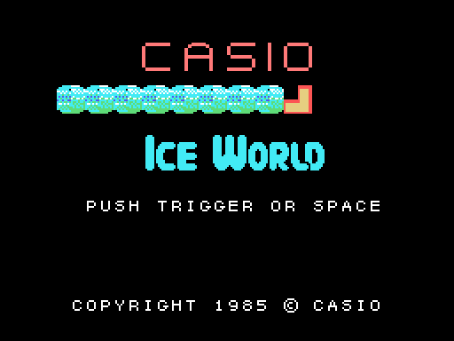
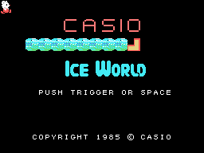
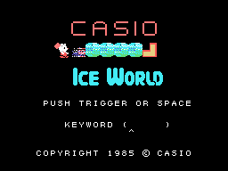
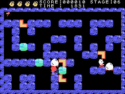
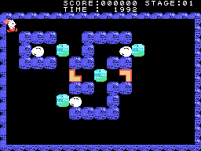

# The game

*Ice World* is a maze of ice seen from above: 50 stages, each a maze of walls with ice blocks, L-shaped pieces
to put together in pairs, eggs and the creatures that come out of them. The stages are in [The stages](THE-STAGES.html).

Every GIF on this site is the ROM **running in openMSX** (a Japanese MSX1, at 60 frames per second): on every
frame the VRAM and the VDP registers are logged, and `tools/vdp.py` paints them.

## The title and the demonstration

On the title the hero walks along a row of ice blocks breaking them. Without touching anything, the computer
plays stage 1 with controls of its own, stored in the ROM (0x9FC1), until button 1 or the space bar
(`demo_mandos`, 0x9DEE).

## KEYWORD

Button 1 or the space bar on the title opens **KEYWORD**: five letters typed on the keyboard, a cursor under
them that the left and right keys move (`contrasena`, 0x8196). If the five letters are one of the ten keywords
of the ROM, the five stages from that one appear below and the cursor picks one; the button starts there. With
nothing typed, the button starts at stage 1. The keywords are in [The texts](THE-TEXTS.html).

## The controls

| | joystick | keyboard |
|---|---|---|
| move | joystick 1 | the cursor keys |
| the hammer | button A | the space bar |
| pause | | F1 |
| give up | | F2 |

The hero moves in four directions, one tile at a time, and **pushes** the L-shaped pieces if there is room
behind them. **Button 1** throws the **hammer** forward (`boton`, 0x982D): it flies until it hits something;
an ice block it hits **breaks** (10 points) and the hammer comes back (`golpe_bloque`, 0x989E). **F1** pauses
the game and F1 again resumes it; **F2** gives the stage up (`paso_f1`, 0x8417).

## TIME and the lives

**TIME** starts at **2000** (100 in the demonstration) and goes down by one every 32 frames (`tiempo`,
0x85FB); at zero it reads **OVER** and the stage is lost. The game starts with **four lives**, drawn at the top
left. A life is lost when TIME runs out, when the hero is under something that kills him (`protagonista_toca`,
0x87A1) or with F2; the stage starts again. With no lives left, **GAME OVER**.

## The points

- A block broken with the hammer, **10**.
- Two L-shaped pieces put together, **100** (`encaja`, 0x8C03).
- A creature crushed, **1,000** or **500** depending on its kind; an egg, nothing (`enemigo_estado3`, 0x928F).
- At the end of a stage, the TIME left is added to the score (`tiempo_puntos`, 0x85CB).
