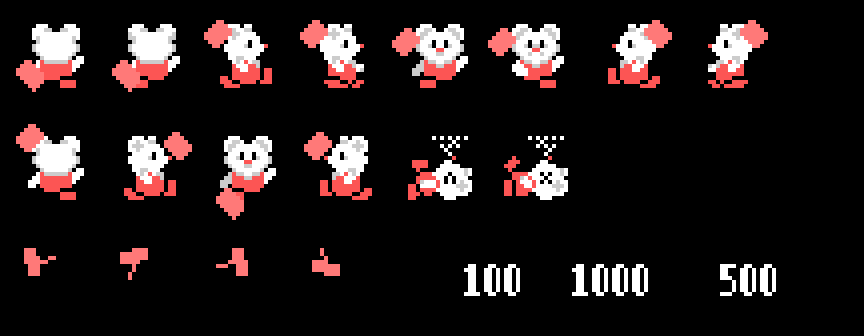
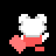
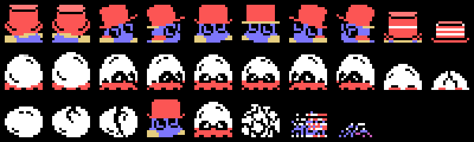
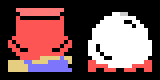

# The sprites

Everything on this page is **put together from the ROM tables** with `tools/hojas.py`: the drawings loaded the way
the game loads them and every figure built from the game's own tables. None of these images is a screenshot.

**Checked against openMSX** on the six recordings of this site:

- the sprite drawing table built here (VRAM 0x3800-0x3FFF) is **identical** to the game's on 50,184 frames (6 more
  catch the copy halfway);
- the tiles 0x40-0xFF of the three thirds, drawings and colours, are **identical** on 33,303 frames (the colours of
  0x68-0x6B and 0x70-0x73 do not count: the game changes them every 4 frames; 247 frames still have the title's
  colours and 189 catch a screen being loaded);
- the hero's three sprites (0xE104) match on **48,058 frames, 0 different**, and their drawing is the one his
  direction and step call for on 46,460 (55 more still show the previous frame's: he has just turned);
- the hammer (0xE100) is where the table puts it on 25,642 frames; 1,903 at the start of a stage (still on the hero),
  257 just after hitting or turning (the place from one frame, the drawing from the next), **14 unexplained**;
- the creatures' tiles on the screen match on 35,621 frames, **0 different** (864 more show the direction before the
  one just chosen, 432 the egg just hatched, 24 the hammer's tile 0x0F and 8 an erased screen).

## The hero and the hammer

Three sprites on top of each other (`prota_sprites`, 0x8C82): the drawing, + 4 and + 8, in white, grey and red
(0x8CC8). Each direction has a pair of drawings (0x8CBE: up 0x48 and 0x54, right 0x18 and 0x24, down 0x30 and 0x3C,
left 0x00 and 0x0C), and the step (0xE202) picks the first or the second (`prota_dibujo`, 0x8C62). The hammer is sprite
0, light red (`golpe_sprite`, 0x9914), and the table 0x99BD gives its place and its drawing for each direction: the
first entry when he holds it, the next one when he hits (0x98B2). The fourth byte of each entry, a 4, is never read.
Top row, walking; then hitting in each direction and the two drawings when he loses (0x60 and 0x6C,
`protagonista_parpadea` 0x880D); below, the thrown hammer (0xB8, 0xBC, 0xC0, 0xC4, `golpe_sale` 0x99F1) and the
points (0xD4, 0xCC or 0xD0 with 0xC8 on the right, `numero_sale` 0x9F69):

Walking, one step per frame like the game, and losing, the two drawings every 4 frames:

The sprites always go **one frame behind** the RAM: the game builds its copy of the table (0xE100) from the hero's
place and then moves him.

## The creatures are tiles

The eggs and the creatures are **not sprites**: they are pieces of 2 × 2 tiles written on the screen (`pieza`,
0x9C09: C and C + 1 on top, C + 2 and C + 3 below), from the tiles `casillas_juego` (0x84C5) loads in each third
(0x600 bytes from 0xA800 from tile 0x40, the stretches of 0xB34C from 0x78 and the colours in stretches from 0xB000).
So they move in jumps of a tile.

There are two creatures, and the eggs take one or the other in turn (`cosas_pon`, 0x9CA3): the one of 0xB0, the red hat, and the one of
0xD8, the white one, which walks only one step in three and is worth 500 crushed instead of 1,000; the thrown hammer
leaves tile 0x0F on it (0x9ACE) and that turns the first into a blue block (piece 0x40, 100 points) and only
stops the second. The piece is (direction - 1) × 4 + 0xB0
or 0xD8, + 4 every other time it moves (`iy_pieza`, 0xB4AD); hit or crushed, + 0x20 (`enemigo_dibujo`, 0x92DC).
Below, the egg cracking (0x48, 0x4C and 0x50, 0x93B8), opening (+ 0x10) and breaking (0x58, 0x5C and 0x60,
`enemigo_rompe` 0x92F2):

They move every 24 frames (`enemigos`, 0x9227) and change drawing each time; crushed, their drawing + 0x20 eight
times and then the three pieces breaking:

