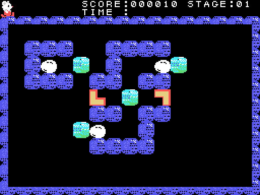
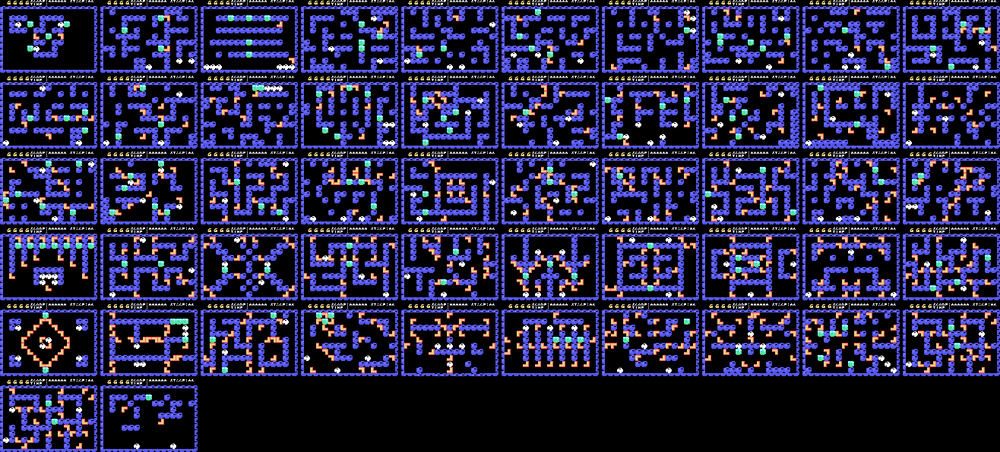
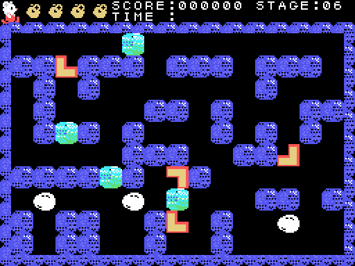
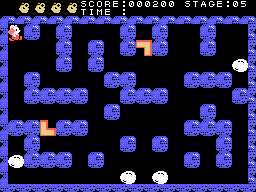
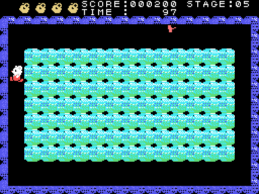
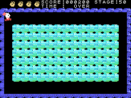

# The stages

## The 52 maps

Every stage the game counts (the stage played, 0xE007, 0 to 51), ten per row and at half size. They are **drawn by
running the ROM** (`tools/mapas.py`): `fase_pantalla` (0x8D97) sets the frame and the scoreboard and `laberinto`
(0x9ADB) the walls and the stage's things, as `fase` does when each one starts (0x83A8-0x83B0). Without the player or
the creatures, which come out afterwards. The bonus stages are something else (a field of blocks) and are not here.

Check: the recordings go through seven of them (stages played 0, 4, 5, 8, 9, 49 and 50); on all seven, the play area
comes out **identical** to the recorded one during the wait at the start, with the maze already drawn.

## What each stage holds

Each stage is drawn from a map of its own (`laberinto`, 0x9ADB): the walls as bits, seven per byte, and then
the loose things by kind (0x9BF1): ice blocks (tile 0x44), eggs (0x48), more wall and the halves of the
L-shaped pieces (0xA0-0xAF). The table at 0xA960 gives a map to each of the 52 stages the game counts; the maps
are spread over six places in the ROM, some of them among the tile drawings and the sprites.

## Putting the pieces together

The hero pushes an L-shaped piece one tile at a time while there is room behind it. When it reaches the piece
that fits it, both become a whole square (tile 0x68): **100 points** and one thing less to do (`encaja`,
0x8C03). The stage ends when nothing is left to do (0xE3CA): one pair in stages 1-5, then one more every five
stages. The TIME left goes to the score, and the next stage.

## The eggs and the creatures

The eggs crack little by little (tiles 0x48, 0x4C, 0x50) and the creature comes out (`huevo`, 0x9323). A
creature looks for the hero: it compares its row and column with his and walks towards him, remembering the
way it has taken for up to eight steps (`enemigo_busca`, 0x9482). Caught between two blocks it is **crushed**:
1,000 or 500 points depending on its kind. An egg between two blocks breaks.

## The bonus stage

After every five stages, before the next one, the game shows the **KEYWORD** of the five stages just played
and a field of 7 × 13 ice blocks (`descanso`, 0x8DCF). TIME is 100; the hammer breaks blocks, and under some of
them, at random, there is something (0x97CE). When TIME runs out, every thing left on the field gives its
points: 100, 300, 500 or 1,000 (`cuenta_casillas`, 0x8E91).

## The end

After stage 50 and its bonus stage comes the end (`final`, 0x8F25): three rows of blocks, the hero breaks them
with controls of his own (0x9073) and under them appear, big, the kanji **神技**, *kamiwaza*, "a divine
skill". When the hero leaves through the top, the game starts again at stage 1.

The bonus stage and the end were recorded **forcing** the game (`tools/guiones/descanso.tcl` and
`final.tcl`): stages 5 and 50 chosen with their keywords, and what was left to do (0xE3CA) set to 0 after
1,000 frames, as the game leaves it when everything is done.
