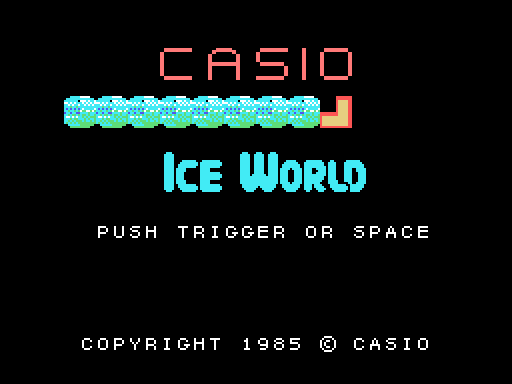
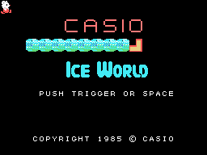
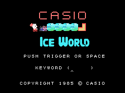
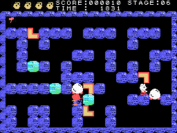
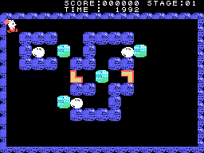

# La partida

*Ice World* es un laberinto de hielo visto desde arriba: 50 fases, cada una un laberinto de paredes con bloques
de hielo, piezas en L que hay que juntar por parejas, huevos y los bichos que salen de ellos. Las fases están en
[Las fases](LAS-FASES.html).

Todos los GIF de esta web son la ROM **funcionando en openMSX** (un MSX1 japonés, a 60 cuadros por segundo): en
cada cuadro se apuntan la VRAM y los registros del VDP, y `tools/vdp.py` los pinta.

## El título y la demostración

En el título el protagonista recorre una fila de bloques de hielo rompiéndolos. Sin tocar nada, el ordenador
juega la fase 1 con unos mandos suyos, guardados en la ROM (0x9FC1), hasta que se pulsa el botón 1 o la barra
(`demo_mandos`, 0x9DEE).

## KEYWORD

El botón 1 o la barra en el título abren **KEYWORD**: cinco letras escritas con el teclado y un cursor debajo
que mueven las teclas de izquierda y derecha (`contrasena`, 0x8196). Si las cinco letras son una de las diez
contraseñas de la ROM, debajo salen las cinco fases desde la suya y el cursor elige una; el botón empieza allí.
Sin escribir nada, el botón empieza en la fase 1. Las contraseñas están en [Los textos](LOS-TEXTOS.html).

## Los mandos

| | mando | teclado |
|---|---|---|
| moverse | el mando 1 | los cursores |
| el martillo | el botón A | la barra espaciadora |
| pausa | | F1 |
| rendirse | | F2 |

El protagonista se mueve en cuatro direcciones, casilla a casilla, y **empuja** las piezas en L si hay sitio
detrás. El **botón 1** tira el **martillo** hacia delante (`boton`, 0x982D): vuela hasta que da con algo; el
bloque de hielo al que da **se rompe** (10 puntos) y el martillo vuelve (`golpe_bloque`, 0x989E). **F1** para el
juego y F1 otra vez lo sigue; **F2** da la fase por perdida (`paso_f1`, 0x8417).

## TIME y las vidas

**TIME** empieza en **2000** (100 en la demostración) y baja uno cada 32 cuadros (`tiempo`, 0x85FB); a cero pone
**OVER** y la fase se pierde. La partida empieza con **cuatro vidas**, dibujadas arriba a la izquierda. Se pierde
una vida cuando se acaba TIME, cuando el protagonista queda bajo algo que lo mata (`protagonista_toca`, 0x87A1)
o con F2; la fase vuelve a empezar. Sin vidas, **GAME OVER**.

## Los puntos

- Un bloque roto con el martillo, **10**.
- Dos piezas en L juntas, **100** (`encaja`, 0x8C03).
- Un bicho aplastado, **1.000** o **500** según su clase; un huevo, nada (`enemigo_estado3`, 0x928F).
- Al acabar una fase, el TIME que queda se suma a los puntos (`tiempo_puntos`, 0x85CB).
