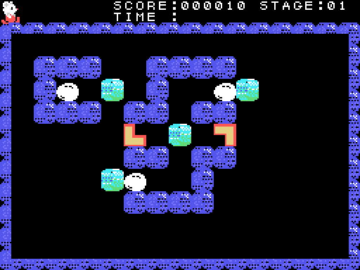
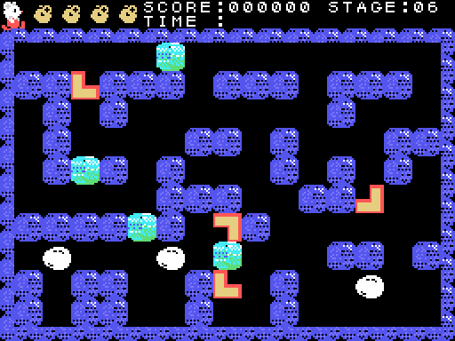
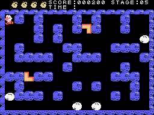
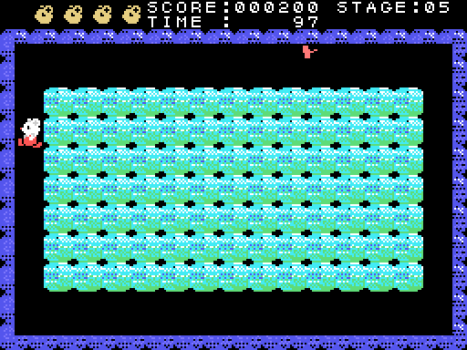
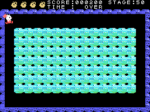

# Las fases

## Lo que tiene cada fase

Cada fase se dibuja desde un mapa propio (`laberinto`, 0x9ADB): las paredes en bits, siete por byte, y después
las cosas sueltas por clases (0x9BF1): bloques de hielo (la casilla 0x44), huevos (0x48), más pared y las
mitades de las piezas en L (0xA0-0xAF). La tabla de 0xA960 da un mapa a cada una de las 52 fases que cuenta el
juego; los mapas están repartidos en seis sitios de la ROM, algunos entre los dibujos de las casillas y de los
sprites.

## Juntar las piezas

El protagonista empuja una pieza en L casilla a casilla mientras haya sitio detrás. Cuando llega a la pieza que
le encaja, las dos pasan a ser un cuadrado entero (la casilla 0x68): **100 puntos** y una cosa menos por hacer
(`encaja`, 0x8C03). La fase se acaba cuando no queda nada por hacer (0xE3CA): una pareja en las fases 1-5, y una
más cada cinco fases. El TIME que queda va a los puntos, y la fase siguiente.

## Los huevos y los bichos

Los huevos se van rompiendo poco a poco (las casillas 0x48, 0x4C y 0x50) y sale el bicho (`huevo`, 0x9323). Un
bicho busca al protagonista: compara su fila y su columna con las suyas y anda hacia él, acordándose del camino
que lleva hasta ocho pasos (`enemigo_busca`, 0x9482). Pillado entre dos bloques queda **aplastado**: 1.000 o 500
puntos según su clase. Un huevo entre dos bloques se rompe.

## La fase de premio

Cada cinco fases, antes de la siguiente, el juego enseña la **KEYWORD** de las cinco fases que se acaban de
jugar y un campo de 7 × 13 bloques de hielo (`descanso`, 0x8DCF). TIME es 100; el martillo rompe bloques, y bajo
algunos, al azar, hay algo (0x97CE). Cuando se acaba TIME, cada cosa que queda en el campo da sus puntos: 100,
300, 500 o 1.000 (`cuenta_casillas`, 0x8E91).

## El final

Tras la fase 50 y su fase de premio llega el final (`final`, 0x8F25): tres filas de bloques, el protagonista las
rompe con unos mandos suyos (0x9073) y debajo aparecen, en grande, los kanji **神技**, *kamiwaza*, "una habilidad
divina". Cuando el protagonista sale por arriba, la partida vuelve a la fase 1.

La fase de premio y el final se grabaron **forzando** el juego (`tools/guiones/descanso.tcl` y `final.tcl`): las
fases 5 y 50 elegidas con sus contraseñas, y lo que quedaba por hacer (0xE3CA) puesto a 0 a los 1.000 cuadros,
como lo deja el juego cuando se ha hecho todo.
