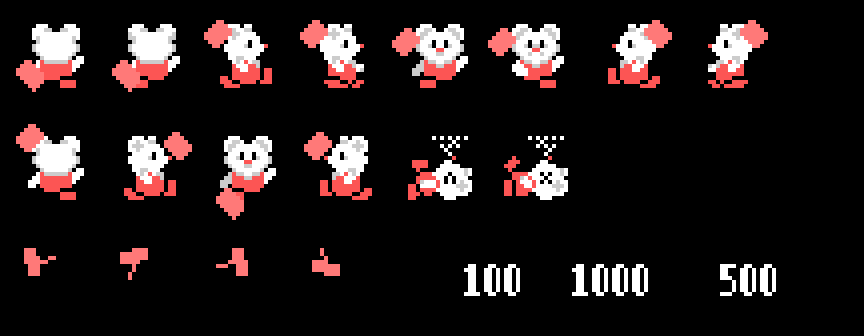
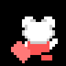
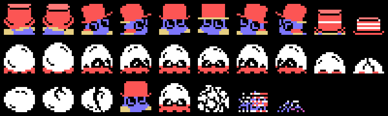
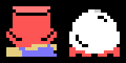

# Los sprites

Todo lo de esta página está **montado desde las tablas de la ROM** con `tools/hojas.py`: los dibujos cargados como
los carga el juego y cada figura armada con las tablas del propio juego. Ninguna de estas imágenes es una captura.

**Cotejado con openMSX** en las seis grabaciones de esta web:

- la tabla de dibujos de los sprites montada aquí (VRAM 0x3800-0x3FFF) es **idéntica** a la del juego en 50.184
  cuadros (otros 6 pillan la copia a medias);
- las casillas 0x40-0xFF de los tres tercios, dibujos y colores, son **idénticas** en 33.303 cuadros (no cuentan los
  colores de 0x68-0x6B y 0x70-0x73, que el juego cambia cada 4 cuadros; 247 cuadros tienen aún los colores del título
  y 189 pillan una pantalla cargándose);
- los tres sprites del protagonista (0xE104) casan en **48.058 cuadros, 0 distintos**, y su dibujo es el que toca a
  su dirección y su paso en 46.460 (otros 55 llevan aún el del cuadro anterior: acaba de girar);
- el martillo (0xE100) está donde lo pone la tabla en 25.642 cuadros; 1.903 al empezar una fase (aún sobre el
  protagonista), 257 justo después de pegar o de girar (el sitio de un cuadro y el dibujo del siguiente), **14 sin
  explicar**;
- las casillas de los bichos en la pantalla casan en 35.621 cuadros, **0 distintas** (otras 864 llevan la dirección
  de antes de la recién elegida, 432 el huevo recién abierto, 24 la casilla 0x0F del martillo y 8 una pantalla
  borrada).

## El protagonista y el martillo

Tres sprites uno encima de otro (`prota_sprites`, 0x8C82): el dibujo, + 4 y + 8, en blanco, gris y rojo (0x8CC8).
Cada dirección tiene una pareja de dibujos (0x8CBE: arriba 0x48 y 0x54, derecha 0x18 y 0x24, abajo 0x30 y 0x3C,
izquierda 0x00 y 0x0C), y el paso (0xE202) elige el primero o el segundo (`prota_dibujo`, 0x8C62). El martillo es el
sprite 0, rojo claro (`golpe_sprite`, 0x9914), y la tabla 0x99BD da su sitio y su dibujo para cada dirección: la
primera entrada cuando lo lleva, la siguiente cuando pega (0x98B2). El cuarto byte de cada entrada, un 4, no se lee
nunca. Arriba, andando; después, pegando hacia cada lado y los dos dibujos de cuando pierde (0x60 y 0x6C,
`protagonista_parpadea` 0x880D); abajo, el martillo lanzado (0xB8, 0xBC, 0xC0, 0xC4, `golpe_sale` 0x99F1) y los
puntos (0xD4, 0xCC o 0xD0 con 0xC8 a la derecha, `numero_sale` 0x9F69):

Andando, un paso por cuadro como el juego, y perdiendo, los dos dibujos cada 4 cuadros:

Los sprites van siempre **un cuadro por detrás** de la RAM: el juego monta su copia de la tabla (0xE100) con el
sitio del protagonista y después lo mueve.

## Los bichos son casillas

Los huevos y los bichos **no son sprites**: son piezas de 2 × 2 casillas escritas en la pantalla (`pieza`, 0x9C09:
C y C + 1 arriba, C + 2 y C + 3 abajo), de las casillas que `casillas_juego` (0x84C5) carga en cada tercio (0x600
bytes de 0xA800 desde la casilla 0x40, los tramos de 0xB34C desde la 0x78 y los colores en tramos desde 0xB000). Por
eso se mueven a saltos de una casilla.

Hay dos bichos, uno en cada huevo por turnos (`cosas_pon`, 0x9CA3): el de 0xB0, el del sombrero rojo, y el de 0xD8,
el blanco, que solo da un paso de cada tres y aplastado vale 500 en vez de 1.000; el martillo lanzado le deja la
casilla 0x0F (0x9ACE), y eso convierte al primero en un bloque azul (la pieza 0x40, 100 puntos) y al segundo solo
lo para. La pieza es (dirección - 1) × 4 + 0xB0 o 0xD8,
+ 4 una vez sí y otra no que se mueve (`iy_pieza`, 0xB4AD); golpeado o aplastado, + 0x20 (`enemigo_dibujo`,
0x92DC). Abajo, el huevo que se agrieta (0x48, 0x4C y 0x50, 0x93B8), que se abre (+ 0x10) y que se rompe (0x58,
0x5C y 0x60, `enemigo_rompe` 0x92F2):

Se mueven cada 24 cuadros (`enemigos`, 0x9227) y cambian de dibujo cada vez; aplastados, su dibujo + 0x20 ocho veces
y después las tres piezas que se rompen:

